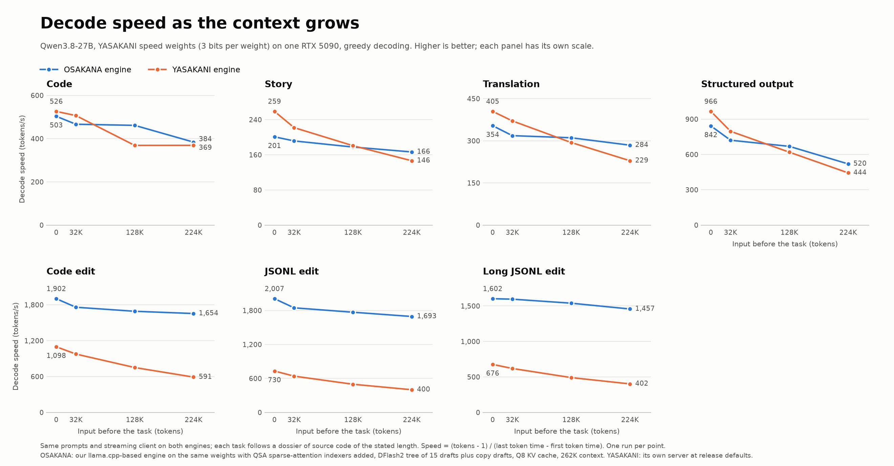

# OSAKANA engine

A llama.cpp-based engine that runs Qwen3.8-27B from 3-bit trellis weights with Qwen Sparse Attention (QSA), at 262K context on one GPU.

It reads the compressed weights of the [YASAKANI](https://github.com/yasakani-dev/yasakani) speed model directly, without decoding them to floating point, and adds three things on top: QSA sparse attention for long inputs, a tree of speculative drafts that works with QSA, and copy drafts for edit-style tasks.

This is an independent project. It is not an official release of YASAKANI, Qwen, Alibaba Cloud, z-lab or Inco AI, and none of them endorses it.

## Results

Decode speed in tokens per second on one RTX 5090, greedy decoding, thinking off. Both engines ran the same prompts through the same streaming client; each task follows a dossier of source code of the stated length. YASAKANI ran on its own server at release defaults.



| Task | YASAKANI, empty | OSAKANA, empty | YASAKANI, 224K | OSAKANA, 224K |
|---|---:|---:|---:|---:|
| Code | 526 | 503 | 369 | 384 |
| Story | 259 | 201 | 146 | 166 |
| Translation | 405 | 354 | 229 | 284 |
| Structured output | 966 | 842 | 444 | 520 |
| Code edit | 1,098 | 1,902 | 591 | 1,654 |
| JSONL edit | 730 | 2,007 | 400 | 1,693 |
| Long JSONL edit | 676 | 1,602 | 402 | 1,457 |

- At empty context YASAKANI is faster on the four writing tasks, by 5 to 29%. OSAKANA is faster on the three edit tasks at every length.
- From empty context to 224K, YASAKANI loses 30 to 54% of its speed and OSAKANA 9 to 38%. At 224K OSAKANA is ahead on all seven tasks; on code the lead is 4%, which is inside run-to-run noise (YASAKANI's structured output figure at 224K was 505 in one run and 444 in another).
- OSAKANA reuses the prompt prefix, so after one prefill a 224K request starts in about 0.6 s. YASAKANI's server prefills the whole input on every request (about 120 s at 224K).

How to read these numbers:

- Speed is (tokens - 1) / (time of the last token - time of the first token). Every figure is one run.
- Structured output is unconstrained on both engines: the JSON schema is in the prompt and no grammar is applied.
- On structured output OSAKANA wrote indented JSON up to 128K and compact JSON at 224K, so its 224K figure is for a different output shape.
- Peak VRAM for OSAKANA was 26.8 GiB with the 262K context reserved.

### Recall at long context

QSA attends to a budget of 2,048 tokens chosen by small indexers, so lookups in long inputs can miss. On a grid of 240 lookup questions over look-alike records (8 task types, 10 depth bins):

| Input length | OSAKANA (sparse) | Dense attention, other weights |
|---|---:|---:|
| 8K | 234 / 240 | 229 / 240 |
| 64K | 232 / 240 | 229 / 240 |
| 128K | 211 / 240 | 222 / 240 |
| 192K | 177 / 240 | 222 / 240 |

The dense column was measured earlier on GSQ-RCO IQ3_S weights of the same base model, not on these weights, so it shows the trend, not an exact control. 255K has not been measured for these weights. If exact recall over very long inputs matters more than speed, run with `LLAMA_QSA_DENSE=1`.

## Quick start

Requirements: Linux, an NVIDIA GPU, CUDA toolkit, CMake. Everything above was measured on an RTX 5090 (32 GB) only; other cards are untested.

```bash
cmake -B build -DGGML_CUDA=ON -DCMAKE_BUILD_TYPE=Release
cmake --build build -j --target llama-server
```

Put the model files in `./models` (see [Model files](#model-files)) and start the server:

```bash
deploy/osakana/serve.sh
```

It serves an OpenAI-compatible API on `127.0.0.1:8091`. The script's header lists its settings (context size, KV cache type, draft tree size). The engine depends on the environment variables that script sets; starting `llama-server` by hand without them gives much lower speed.

Memory: the defaults need about 26.8 GiB. A Q8 KV cache holds the full 262K context; an F16 KV cache fits up to about 229K tokens on a 32 GB card and was not faster in our runs.

## Model files

| File | What it is |
|---|---|
| `Qwen3.8-27B-OSAKANA-speed-QSA.gguf` | Main model: YASAKANI speed weights (3 bits per weight) kept as trellis codes, plus 16 QSA indexers |
| `Qwen3.8-27B-DFlash2-OSAKANA-IQ4_XS.gguf` | DFlash2 draft model, fine-tuned for tree drafts |
| `osakana-shead.ysh` | Shortlist head: lets the draft model pick its top tokens without reading the whole output head |

To make them yourself, with the tools in [`deploy/osakana/tools`](deploy/osakana/tools):

1. `yskn_to_hf.py` decodes a YASAKANI `.yskn` file to a Hugging Face style folder; `convert_hf_to_gguf.py --no-mtp` turns that into an F16 GGUF.
2. `yskn_to_ytr_gguf.py` writes the GGUF that keeps the original trellis codes, using the F16 GGUF as a template and checking every tensor against it.
3. `add_qsa_indexers.py` copies the QSA indexers from a QSA GGUF of the same base model.
4. `build_shead.py` builds the shortlist head from the F16 GGUF and a dump of the draft model's hidden states (`GGML_YTR_SHEAD_DUMP`).

## What is different from llama.cpp

- **Trellis weights read natively.** Two new tensor types, `YTR3` and `YTR4`, hold YASAKANI's trellis codes. The CUDA kernels decode them on the fly into int8 and multiply on tensor cores with int8 activations, so a decode step reads 3 bits per weight from memory.
- **Fused small steps.** The finish of each product is fused with the residual add, the norm and the next product's input, and products that share an input run in one launch.
- **QSA with tree drafts.** A tree of 15 draft tokens is verified in one pass. After each round the rows of the accepted branch are moved to the front of the batch's cache cells, in both the attention cache and the indexer cache, so QSA's block path keeps working.
- **Copy drafts.** When the output repeats a span of the input, up to 63 tokens are drafted from the input and verified in one wide pass.
- **Shortlist head for the draft model.** A rank-512 sketch of the output head picks 960 candidates, which are then scored exactly.

One approximation is specific to this engine: a row of the draft tree always attends to the blocks its own ancestors fill, where plain sequential QSA would let those blocks compete in the top-k selection. It concerns at most the last 16 tokens. Recall at 64K was the same with tree drafts and with chain drafts (232 / 240 each).

## Limits

- Measured with greedy decoding only. Sampled decoding with tree drafts is untested.
- One slot, one GPU. The trellis kernels exist for CUDA only.
- The main model has no vision projector and no MTP head.
- Quality of the weights is that of the YASAKANI speed model: against the BF16 original, KL divergence 0.057 on our prose text and 0.212 on code (top-1 agreement 90.9% and 89.1%).
- The speed comparison is one run per figure on our own prompts. YASAKANI's published numbers use its own prompts.

The earlier README of this code base, for the 24 GB QSA setup, is in [README.qsa27b-24gb.md](README.qsa27b-24gb.md). The upstream llama.cpp README is in [README.upstream.md](README.upstream.md).

## Credits and licences

- [llama.cpp](https://github.com/ggml-org/llama.cpp), MIT. See `LICENSE`, `LICENSE-freetoken` and `LICENSE-pcie-patches` for the code this tree builds on.
- The weight format and the speed model come from [YASAKANI](https://github.com/yasakani-dev/yasakani) (Apache-2.0). This engine reimplements the reading of that format.
- [Qwen3.8-27B](https://huggingface.co/Qwen/Qwen3.8-27B) by the Qwen team, Apache-2.0.
- QSA and its indexers come from higa2515's Qwen3.8-27B QSA release ([higa2515/Qwen3.8-27B-QSA-BF16](https://huggingface.co/higa2515/Qwen3.8-27B-QSA-BF16), GGUF files in [higa2515/Qwen3.8-27B-QSA-GGUF](https://huggingface.co/higa2515/Qwen3.8-27B-QSA-GGUF)); the indexers used here were recalibrated for long context.
- The draft model derives from [DFlash2 for Qwen3.8-27B](https://huggingface.co/z-lab/Qwen3.8-27B-DFlash2) (z-lab, a mirror of Inco AI's model), Apache-2.0.
